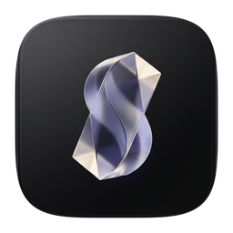
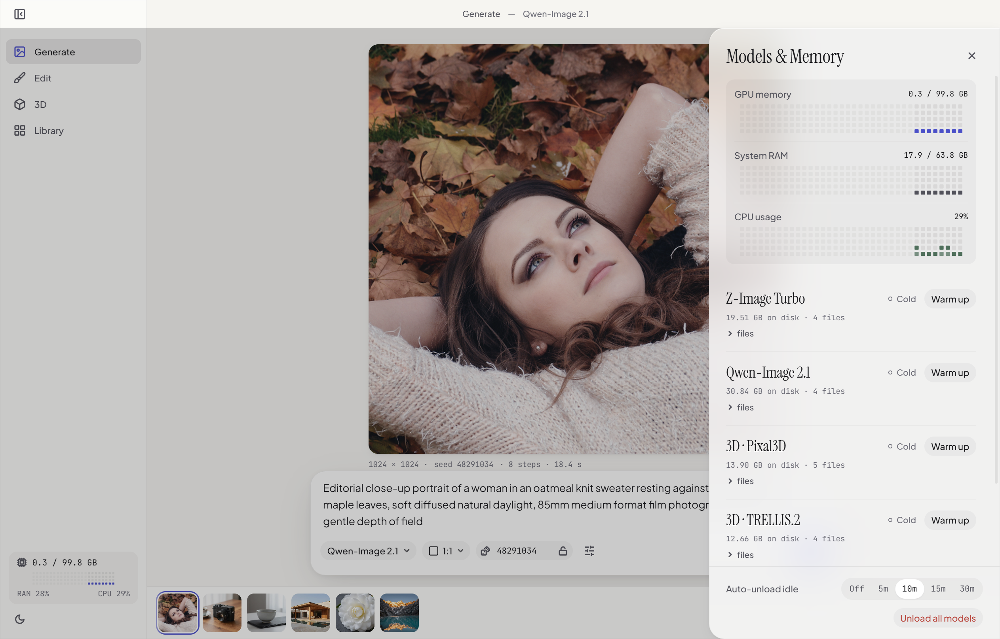
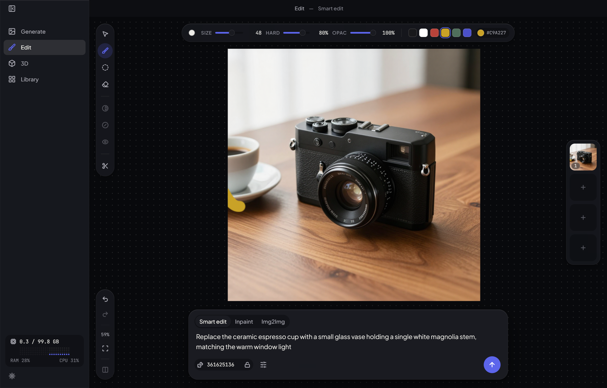
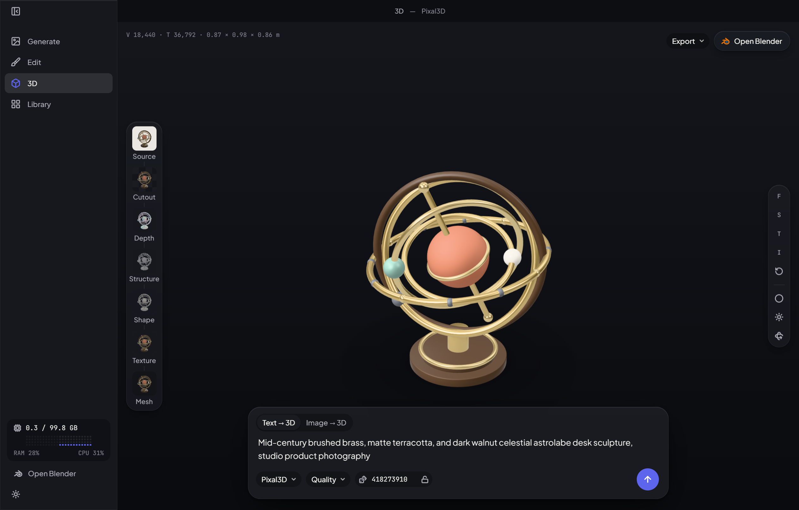

  
  <h1 align="center">Studio</h1>

  A native Windows 11 creative suite for local image generation, canvas editing, and 3D modeling.

  

## Features

| Feature | Description |
| --- | --- |
| **Generate** | Create images locally from text prompts with live previews and queueing. |
| **Edit** | Paint, mask, remove backgrounds, and edit images on a floating canvas. |
| **3D** | Turn text or images into textured 3D meshes and send them straight to Blender. |

## Screenshots

| Models & Telemetry | Edit & Canvas |
| --- | --- |
|  |  |

| 3D Studio | Library & Inspector |
| --- | --- |
|  |  |
