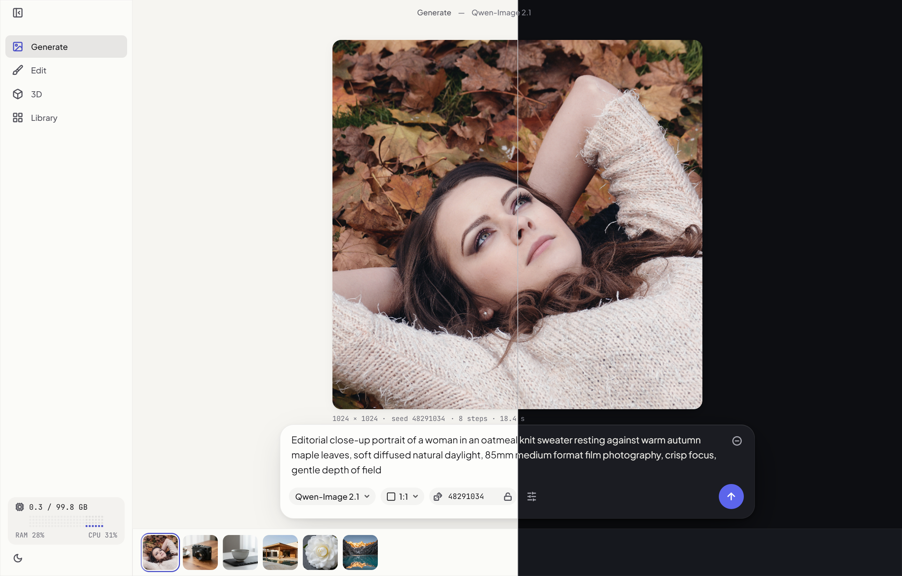
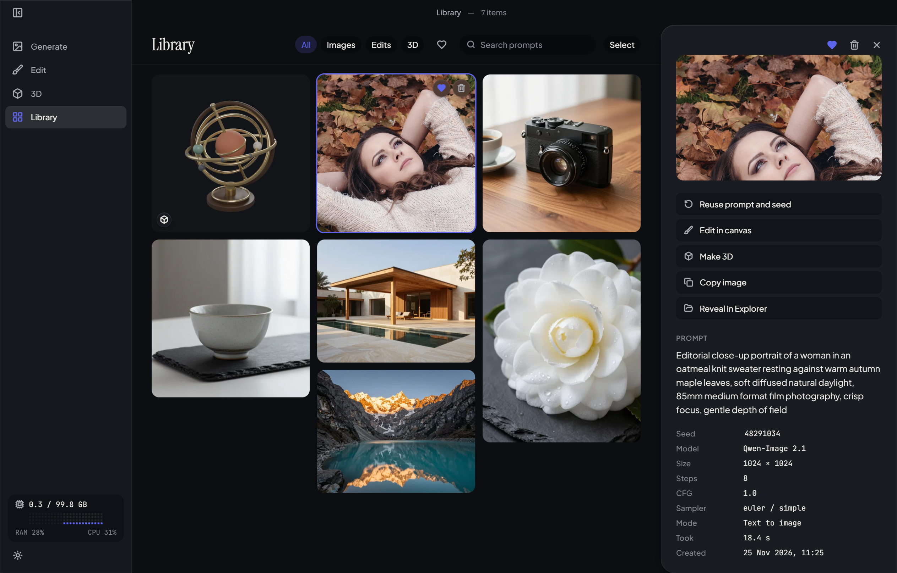

<p align="center">
  
  <h1 align="center">Studio</h1>
</p>

<p align="center">
  A native Windows 11 creative suite for local image generation, canvas editing, and 3D modeling.
</p>

<p align="center">
  
  <br><sub>Zen Light and Zen Dark — local image generation, live CPU/RAM/GPU telemetry, and filmstrip history.</sub>
</p>

Everything runs locally on your machine. Generate images with Z-Image Turbo or Qwen-Image 2.1, paint masks and brush edits on a floating canvas, turn text or photos into textured 3D meshes with progressive stage previews, and manage models and memory from one desktop window.

## Workspaces

- **Generate** — Text-to-image generation with **Z-Image Turbo** and **Qwen-Image 2.1**, live latent preview reveals rendered through a WebGL2 murmuration shader, filmstrip history, and a global job queue with a slide-over queue drawer.
- **Edit** — Layered Canvas2D editing (`Paintbrush`, `Mask brush`, `Eraser`, undo/redo history, and a before/after wipe) with one-click BiRefNet background removal, Inpaint, Img2Img, and multi-reference editing via Qwen-Image 2.1.
- **3D** — Text-to-3D and Image-to-3D via **Pixal3D** and **TRELLIS.2** with 7 progressive milestone stages (`Source`, `Cutout`, `Depth`, `Structure`, `Shape`, `Texture`, `Mesh`), a lazy-loaded Three.js PBR viewport (camera presets, shading modes, studio lighting), and multi-format export (`.glb`, `.obj`, `.stl`, `.fbx`, `.blend`).
- **Library** — Virtualized masonry gallery with prompt search, kind/favorite filters, a slide-over inspector, Recycle Bin deletion via `studio-core`, and cross-workspace drag-and-drop (including spring-loaded sidebar tab switching).

## Screenshots

| Models & Telemetry | Edit & Canvas |
| --- | --- |
|  |  |

| 3D Studio | Library & Inspector |
| --- | --- |
|  |  |

## Local Models

| Family | Role | Used In |
| --- | --- | --- |
| **Z-Image Turbo** | Fast text-to-image diffusion (`9`-step default) | Generate |
| **Qwen-Image 2.1** | High-detail image synthesis and multi-reference editing | Generate, Edit |
| **BiRefNet** | On-device foreground cutout and background removal | Edit, 3D |
| **Pixal3D** | Text/image to multi-stage textured 3D mesh | 3D |
| **TRELLIS.2** | Structured latent 3D mesh generation | 3D |

You can load, warm, or unload individual families from **Models & Memory**, set an auto-unload idle timeout, and monitor live GPU memory, System RAM, and CPU usage graphs in both the sidebar and the drawer.

## Blender Integration

Inside the **3D** workspace, Studio connects to a local **Blender 5.3** add-on ([`blender/studio_bridge.py`](./blender/studio_bridge.py) on `127.0.0.1:48215`) and headless converter ([`blender/export_mesh.py`](./blender/export_mesh.py)) so you can launch Blender or send any generated mesh straight to your scene.

## Architecture

- [`app/`](./app/) — Electron 35 shell (`app/electron/`) and React 19 + TypeScript + Tailwind CSS + WebGL2 + Three.js renderer (`app/src/`).
- [`engine/`](./engine/) — Standalone Python 3.12 + PyTorch ROCm HTTP/WebSocket daemon (`studio_engine` on `127.0.0.1:48210`).
- [`core/`](./core/) — Stateless Rust CLI (`studio-core`) handling model scanning, 512 px WebP thumbnails, Recycle Bin deletion, and system/GPU telemetry.
- [`blender/`](./blender/) — Live Blender 5.3 bridge add-on and headless mesh exporter.
- [`docs/`](./docs/) — [`DESIGN_SPEC.md`](./docs/DESIGN_SPEC.md) and [`API_CONTRACT.md`](./docs/API_CONTRACT.md).

## Build from source

Requires Windows 11, Rust (`cargo`), [Bun](https://bun.sh), Electron, and your local `models/`, `runtime/`, and `engine/vendor/` directories (excluded from git via `.gitignore`).

```powershell
# 1. Build the native Rust core CLI
cd core
cargo build --release

# 2. Install dependencies and build the Electron + React bundles
cd ..\app
bun install
bun run build

# 3. Launch Studio (ensure ELECTRON_RUN_AS_NODE is unset)
Remove-Item Env:ELECTRON_RUN_AS_NODE -ErrorAction SilentlyContinue
.\node_modules\electron\dist\electron.exe .
```
